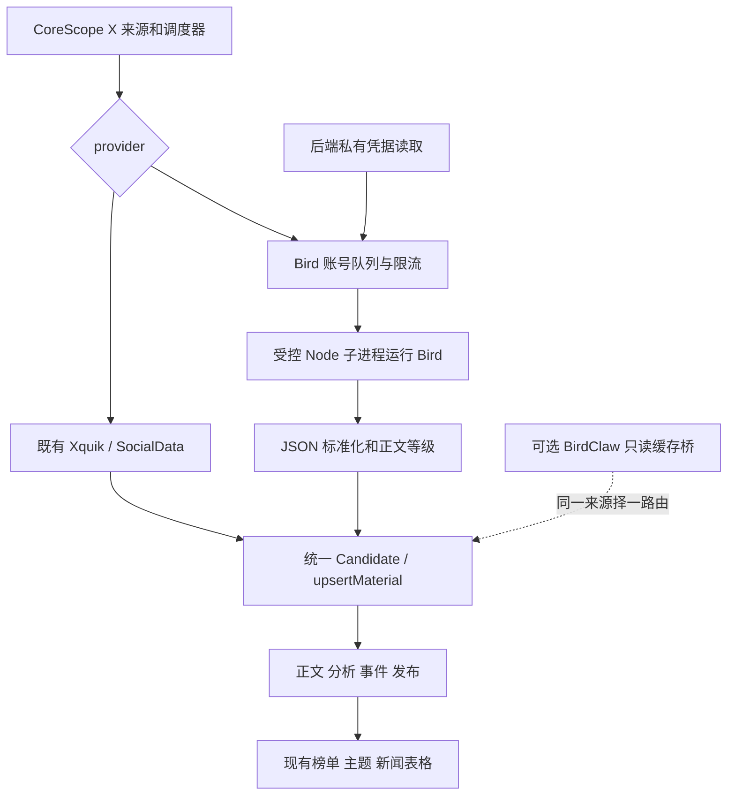

# CoreScope 借用 Bird 采集 X 的设计与改动评估

日期：2026-10-13；状态：设计基线，主体方案已实施。当前真实验收和运行边界见 [Bird运行与验收](CORESCOPE_BIRD_OPERATIONS.md)。下文现状快照来自设计评估阶段。

评估对象：CoreScope 当前本地代码 `b3a05bb`，以及 `D:\birdclaw-upgrade-v0.13.0` 当前定制工作区。BirdClaw 工作区存在既有本地改动，结论针对本机版本，不直接等同于上游仓库。

设计评估阶段只读检查了源码、本机CLI、配置与数据库，未执行Bird网络采集或模型请求。本文的提案以运行与验收说明所记录的实际实现为准。

## 1. 结论和推荐决策

可以复用 Bird。推荐在 CoreScope 新增第三种 X 采集方式 `provider=bird`，由 CoreScope 自己调度 Bird CLI，继续使用现有来源 ID、`x:<tweetId>` 去重、正文处理、分析、事件和发布流程。

复用的是本机 Bird 程序、BirdClaw 的凭据来源和 Windows 调用经验；不把整套 BirdClaw 应用嵌入 CoreScope。Bird 0.8.0 要求 Node >=22，CoreScope 的 Node 24 已满足，不需要引入 BirdClaw 的 Node 26、Effect、前端或服务器。

实施顺序建议：

1. 先从 BirdClaw 本地库只读提取目标作者样本，用于字段适配、长文和去重验证；这一步不增加 X 请求，也不必先建设一个生产缓存桥。
2. 建设 CoreScope 独立 Bird provider，先验证 3–5 个账号的真实追新、入库和展示。
3. 根据账号总负载与实测限制扩大覆盖。114 个来源全部切换前，必须有可核验的容量和轮询时效，不能以“配置启用”代替“采集正常”。

现有登录账号与 BirdClaw 共用时，CoreScope 单方限流无法约束两套系统的合计请求量。可以做低额度试点，但不承诺合计额度或稳定性。长期优先使用独立采集账号；若坚持共用同一账号并要求严格总限流，需要双方接入共享 Bird 读取协调器，属于额外实施范围。另开同一账号的会话可以隔离 Cookie 管理，但不能证明账号级限额独立。

## 2. CoreScope 当前如何获得 X 信息

### 2.1 已核实的数据状态

以下为 2026-10-13 15:35（北京时间）的只读快照，指标会随运行变化：

| 项目 | 当前结果 | 解释 |
|---|---|---|
| 启用的 X 来源 | 114 个，全部 `provider=xquik` | 当前没有 Bird provider；默认兼容 SocialData，但本机没有启用的 SocialData X 来源 |
| 来源配置间隔 | 30–180 分钟 | 普通账号还会进入现有合并查询分片，实际调度不能仅看来源间隔 |
| 最近成功 X 入库 | 2026-10-12 22:52:46 | 最近一次轮询不等于最近一次成功采集 |
| 已归属 X 来源的材料 | 175 条 | 原始材料数，不等于公开精选条数 |
| 过去 24 小时成功来源轮次 | 335 次，新增 165 条材料 | 分片请求可以对应多个来源轮次 |
| 预算阻断的来源检查 | `credits-day` 5,716 次；`minute` 981 次 | 是本地检查记录，不能解释成同等数量的 X 请求或收费调用 |
| Xquik 请求账本 | 过去 24 小时 50 次 live attempt；请求日上限 120 | 另外受 credit 日上限和余额保留约束；当前主要阻断是 credit 日额度，不能因 50 <120 判断额度未用完 |

因此，当前 X 内容经过 Xquik 付费 REST 接口获取，近期更新受预算门控影响。接入 Bird 可以增加另一条独立采集路线，但不会自动消除分析预算、正文缺失或发布筛选造成的延迟。

### 2.2 当前链路

```text
每分钟检查到期来源
  → 解析 from:handle -filter:replies
  → Xquik 首抓小批次 / 初始化后的账号合并查询
  → GET /x/tweets/search
  → 标准化推文 → Candidate
  → upsertMaterial，按 x:<tweetId> 去重和管理 revision
  → 正文补全、筛选、分析、事件归并、发布
```

普通查询使用 Latest；初始化后每个查询分片最多 24 个账号、查询长度不超过 470 字符。现有 `editorial` 分片 30 分钟，`hot_signal` 分片 60 分钟；首次 Xquik 查询每组最多 3 个账号。请求通过回执、请求预算及 credit 预留后才发送。

源码默认每页 5 条、每轮最多 2 页、首次回看 7 天、credit 日上限 250、余额保留 100。这些是源码默认值，不作为本机私有配置生效值的证明。

来源游标现有 `lastTweetId`、`initializedAt` 和 `xBacklog[{query,next}]`。普通 Note Tweet 的长正文直接标准化；X Article 按原帖 ID 另走正文接口。代码只支持 `socialdata | xquik`，新增 Bird 要改真实调用分支和正文分支。

## 3. BirdClaw 的 Bird 机制和可复用部分

### 3.1 本机已核实条件

| 条件 | 核实结果 | 复用方式 |
|---|---|---|
| Bird CLI | `@steipete/bird 0.8.0` | 先使用本机已安装版本验证；不覆盖全局包 |
| CLI 文件 | `C:\Users\30424\AppData\Roaming\npm\node_modules\@steipete\bird\dist\cli.js` | 以明确路径、版本及文件校验识别运行程序 |
| Bird 运行要求 | Node >=22 | CoreScope Node 24 可以运行，不依赖 BirdClaw Node 26 |
| X 认证来源 | 当前用户环境 `AUTH_TOKEN`、`CT0` 均存在 | 由 CoreScope 后台安全读取，仅注入 Bird 子进程；本轮未验证 Cookie 有效性 |
| BirdClaw 配置文件 | `D:\birdclaw-upgrade-v0.13.0-data\config.json`，顶层为 `ai/timeline/backup` | 文件没有 X Cookie；不能误把整个 JSON 复制成 CoreScope 认证配置 |
| 网络 | BirdClaw 启动脚本默认代理 `http://127.0.0.1:7897`，启用 Node 环境代理 | 沿用已有网络方式，实施时验证代理和 Node24 实际连通；本轮未验证 X 连通 |
| 本地数据库 | `D:\birdclaw-upgrade-v0.13.0-data\birdclaw.sqlite`，schema 11 | 可只读取样或另建缓存桥；不运行 BirdClaw DB 初始化/迁移函数 |

Bird 通过 X 网页 GraphQL 和 Cookie 认证读取，不是 Xquik REST API，也不是浏览器逐页截图。登录账号是采集凭据的身份；目标 `@OpenAI` 等是被观察的公开作者，两者必须分开。

BirdClaw 的 Home 同步主要使用 `home --following`，读取登录账号的关注时间线。其现有封装还提供 search/read/thread/mentions，但没有指定账号 `user-tweets` 的应用封装。Home 推荐、关注和覆盖范围不能视为对 CoreScope 全部目标账号的定时完整抓取。

### 3.2 缓存能覆盖多少目标账号

本轮从 schema 11 的 `tweets + profiles + tweet_account_edges` 只读核对 `acct_primary/home`：114 个目标作者中命中 **64 个**，共有 **12,006 条**归属这些作者的已有推文；其中 55 个作者最近一条推文在近 7 天窗口。目标作者最新推文时间为 **2026-10-13 14:56:48**，最近观察时间为 **15:14:03**。

这证明缓存可用于立即取样和部分内容接入，不证明 64 个账号均被完整采集，也不证明所有材料符合“原创、非回复”的 CoreScope 筛选。其余 50 个目标作者在该账户 Home 记录中没有命中。

推文正文的主存储是 `tweets.text`，并结合作者表和账户边记录；`sync_cache` 用于同步缓存、游标和报告等，不应当作原始推文的唯一来源。报告缓存也不能直接混入原始 X 新闻。

### 3.3 Bird 维护状态

截至本轮，[npm 包元数据](https://registry.npmjs.org/@steipete/bird/0.8.0)及[包页面](https://www.npmjs.com/package/@steipete/bird)已经把该包标记为 deprecated、停止支持。原 `steipete/bird` GitHub 地址本轮访问返回 404；不能依赖它持续提供修复。

因此方案以本机可检查的 0.8.0 为基准，固定版本、记录来源和完整性，隔离适配代码，预留 query-ID/响应变化的处理和回滚。能运行 `--version` 只证明本机程序可启动，不证明当前 X 端点仍能采集。

## 4. 路线比较和范围选择

| 路线 | 能力 | 新增依赖/范围 | 建议 |
|---|---|---|---|
| A. CoreScope 直接调用 Bird | 独立指定账号采集、按需搜索和补全文；可以逐步覆盖 114 个目标账号 | Bird 程序、会话、代理、provider/调度/游标适配 | 主体方案 |
| B. 只读 BirdClaw 缓存桥 | 消费 BirdClaw 已采集推文，不增加 X 请求 | SQLite 只读读取器、来源映射、增量账本；或受限 HTTP 查询 | 可选生产方案；也可仅用于 A 的离线取样 |
| C. 共享 Bird 读取协调器 | 两套系统共用账号并统一并发、冷却和请求预算 | 本机网关、生命周期管理、两端调用适配和鉴权 | 严格共享额度时的额外范围 |

不建议直接 import BirdClaw 的应用入口、调用它的同步任务，或使用报告生成接口作为采集接口。这会把服务生命周期、数据库迁移、模型调用和备份副作用带入 CoreScope。

主方案 A 采用作者时间线 `user-tweets`。第一期不把 Bird 塞进现有付费查询分片：Bird 的作者时间线与 OR 搜索的返回及覆盖语义不同。复杂主题查询可使用单独 `search` 入口；账号 OR 合并搜索只作为后续验证过的容量优化，不作为首版完整性基础。

## 5. 主方案的模块和接口



### 5.1 配置契约（提案，当前系统尚不识别）

保留原来源 ID 和 `kind=x_search`，仅更换采集方式。例如：

```json
{
  "query": "from:OpenAI -filter:replies",
  "searchType": "Latest",
  "provider": "bird",
  "bird": {
    "accountProfile": "birdclaw-primary",
    "strategy": "user_tweets",
    "initialLookbackHours": 48,
    "maxPagesPerRound": 1
  }
}
```

`accountProfile` 是 CoreScope 私有认证配置的引用，不是目标作者，不是 Cookie，也不自动等同于 BirdClaw 数据库账户 ID。目标作者由严格解析的 `from:` 规则确定，句柄限制为合法字符。复杂查询必须显式使用 `strategy=search`，不能静默退化成只抓第一个作者。

建议新增非敏感配置：`BIRD_ENABLED`、`BIRD_CLI_PATH`、`BIRD_NODE_PATH`、`BIRD_CREDENTIAL_MODE`、`BIRD_PROXY_URL`、请求时限、输出上限和 alias 级预算。默认关闭；来源切换采用显式名单和 dry-run。

认证提案：

- 本机复用模式读取当前 Windows 用户的 `AUTH_TOKEN/CT0`，按账号 profile 分别设置预期登录 user ID；不要求用户把 Cookie 粘贴到来源 JSON。
- Windows 托管进程不能只依赖 Codex 或旧父进程的环境快照。启动器显式读取当前用户配置后，只传给 backend/Bird 子进程；凭据更新需有重载机制。
- 缺少任一 Cookie 即返回配置缺失，不调用 Bird，避免它自动从浏览器读取另一个账号。
- 必要的 Node/系统/临时目录/代理环境使用白名单；不把 CoreScope 数据库、模型、管理员和 V2 的密钥传给 Bird。
- Cookie 不出现在 CLI 参数、状态页、回执、日志、原始响应文件或 Git 中；代理含认证时同样处理。
- `whoami` 在未来实施验收时用于核对登录身份，不在每个目标作者采集前都重复调用。身份失配即停止该 profile。

### 5.2 调用契约

建议使用 `spawn(nodePath, [cliPath, ...args], {shell:false, windowsHide:true})`，绕开 Windows `.cmd` shim；借用 BirdClaw 的 npm shim 解析经验即可，无需复制整个 Git Bash/Effect 调用栈。

未来调用形态示例，凭据通过私有环境注入：

```text
node <固定Bird CLI路径> --timeout 20000 --quote-depth 1 user-tweets OpenAI -n 20 --max-pages 1 --delay 1000 --json-full
node <固定Bird CLI路径> --timeout 20000 read <tweet-id> --json-full
```

读取命令白名单：`user-tweets/search/read/thread/whoami/--version`。`thread` 仅按需、限页、限制作者范围；禁止发帖、回复、点赞、关注、私信等写命令。不能使用 `bird check` 做健康检查：本机实现会打印 Cookie 前缀。

Bird JSON 有数组和 `{tweets,nextCursor}` 两种形态，适配器需要分别处理。`user-tweets` 每页最多 20 条，包内单次上限 10 页/200 条，但其内部后页失败时 CLI 不输出此前成功页。因此本方案强制每次 CLI `--max-pages 1`，由 CoreScope 按 `nextCursor` 逐页调用、保存回执和入库；`maxPagesPerRound` 仅约束 CoreScope 每轮调用的总页数，不改变单次 CLI 的一页契约。

本机 CLI 在空页或新增条数为零时还会抹掉 bottom cursor。此时不能凭缺少 cursor 宣称完整覆盖：记录空响应/unknown或gap，保留旧覆盖水位，下一轮仍从最新页检查。若要求恢复 CLI 丢弃的原始 cursor，需要受控 Bird补丁或SDK适配，属于新增范围；不能承诺只包装原CLI就能消除该限制。

父进程总时限建议 45 秒、JSON 上限 8 MiB，超限失败且保留已确认数据。Bird 内部 query-ID discovery 没有完整的请求时限保障，必须支持父任务取消并终止自己拥有的子进程；Windows 实施时验证 PID/创建时间或受控 Job，禁止按进程名批量停止 Node。

显式设置 `BIRD_QUERY_IDS_CACHE=<CoreScope .data>/runtime/bird/query-ids-cache.json`，避免与 BirdClaw 默认用户缓存互写。

### 5.3 数据规范化

| 输入/证据 | CoreScope 字段或处理 | 约束 |
|---|---|---|
| 推文 ID | `identityKey=x:<id>`、`xPost.tweetId` | 十进制字符串；比较用 BigInt，不转 Number |
| 作者 user ID / handle | 原始作者证据、来源匹配 | 作者必须匹配目标来源；引用作者不推进目标作者水位 |
| `createdAt` | `publishedAt` | 使用原始发布时间，不以采集时间替代 |
| Note Tweet / full_text | `bodyText`、`xPost.text` | 优先长正文，不取展示截断文本 |
| permalink | 规范化 `https://x.com/<handle>/status/<id>` | 同一推文不因供应商不同变成多篇材料 |
| reply / repost / quote | 独立类型和上下文 | 复用原来源政策；不把转发目标伪装成目标作者原创 |
| media / metrics | 既有媒体和 raw 互动字段 | 不为了媒体额外无界下载或扩展回复树 |
| provider / observedAt / receiptId | 材料 provenance、回执 | 所有 Bird 材料显式记录 `provider=bird` |
| Article / thread coverage | 正文等级、完整性和缺失原因 | 区分 `full/partial/preview/unknown`，不把摘要标成全文 |

新正文等级可保存在 `x_post`/`raw` 的可选字段，不要求先改文章主表。最终适配仍以现有 `body_status=ok/pending/unconfirmed` 驱动分析。

### 5.4 增量、分页和覆盖水位

每次追新重新从作者时间线顶部开始。Bird 的 bottom cursor 向旧数据翻页，不能拿上一轮 cursor 当下一轮追新起点。

建议游标保留公共 `lastTweetId/initializedAt`，增加 `bird` 子对象记录已观察最高 ID、最近成功追新时间、覆盖状态和有限 backlog。回溯任务保存其下界、水位、时间区间、供应商 cursor 和剩余页数；不同 provider 的 opaque cursor 不可互用。

处理规则：

1. 排除置顶老帖、转发/引用和不匹配作者对截止判断的影响；不能遇到一个老置顶帖就停止整轮。
2. 首抓限定 48 小时和页数，不一次回灌多年历史；现有历史归档/首导入限额继续生效。
3. 页面原始响应先记回执，合法材料入库后，在同一业务事务中确认来源游标和回执。崩溃后的重放必须幂等。
4. 后续页失败时保留已成功页，同时保存未覆盖区间；可以记录已观察高水位，但不能把部分轮次记成完整覆盖。
5. 置顶、重复 cursor、空页但仍有 cursor、ID/作者/日期错误均有专门处理；无效响应不推进成功覆盖水位。
6. 长时间停机及 provider 切换使用受限重叠补抓，优先最新页，再逐步回补 backlog；到达页数/日额度时显示 partial/gap。
7. 每次观测的数据都不代表 X 全站绝对完整性；后台展示“最近成功、返回数、覆盖状态和缺口”作为可核验范围。

## 6. 限流、共享账号和容量

Bird 没有 Xquik credit 消费，但仍消耗 X 会话请求额度。一个 CLI 调用可能包含作者 user ID 查询、时间线页、query-ID 修复和 Article 补全文，不能把 CLI 调用次数称为精确 HTTP 请求次数。

第一期建议 alias 并发 1、每分钟最多 1 次 CLI、每小时最多 10 次、滚动 24 小时最多 120 次；3–5 个试点作者每 2 小时一次，留出认证和正文补全额度。这是待实测调整的保守试点策略，**不是 X 官方安全阈值**。后台手工抓取、预览和补全文同样走 gate。

114 个作者全部按 3 小时轮询，单页追新至少需要 `114×8=912` 次 CLI/天；若每次都查询作者 ID 和一页时间线，通常至少约 1,824 个上游调用，还没计入分页、Article 或修复。30 分钟轮询会更高。不能用 120 次试点额度承诺 114 个账号原有频率。

扩大覆盖采用优先级和公平轮询，明确每个作者的时效目标、实际等待和缺口；分别预留追新、回补、正文额度。优化顺序为实测缓存作者 ID的隔离适配、减少无意义详情调用，以及有覆盖证明的 search 分组。可选直接 SDK 优化另行评估，本方案首期保持 CLI 隔离。

| 失败 | 建议动作 | 对数据的影响 |
|---|---|---|
| 缺少认证 / 身份不匹配 | 停止该 profile，显示配置/认证错误 | 不删除既有材料，不推进游标 |
| 401/403 | 区分账号认证与单作者访问；账号错误熔断，单目标私有/删除可隔离 | 不循环登录，不换 Cookie 重试 |
| 429 | 使用可得 Retry-After；否则指数冷却并加抖动，暂停 profile | 不继续开其他来源消耗同一 profile |
| 网络超时/5xx | 有限重试，受总时限和日额度约束 | 部分页保持可重放，标记缺口 |
| 404/query-ID/JSON 结构变化 | 限定一次修复尝试；继续失败暂停 provider并保留证据 | 不把空/异常响应当“没有新帖” |
| 本地额度耗尽 | 排程到下一可用时间，显示 deferred | 不把每分钟重新检查累积成大量真实请求 |

回执使用 `service=bird`，保存稳定请求键、目标、运行窗口、页数、tweet 数和脱敏响应；cost 可为 null，不能伪称已核实精确成本。复用既有回执事务契约时不使用 Xquik credit 余额/预留接口；缺少 Bird budget 默认拒绝调用。

跨系统限制必须明示：BirdClaw 自己的 account-sync 锁不是两套系统共享的锁。CoreScope 的文件锁或 PostgreSQL 锁只能管自己的入口。方案 C 需要 BirdClaw 也经统一协调器读取；仅在 CoreScope 加锁不能声称实现总限流。高负载的同一账号独立会话也不等于独立账号额度。

## 7. 长文、线程和发布质量

Bird 0.8.0 可解析 Note Tweet、Article content_state/plain_text，并提供 read/thread。作者时间线请求本身设置 `withArticlePlainText:false`，Article 常常只有标题或 preview，因此必须按需用原帖 `read` 补正文。

Article 判定同时检查 Bird 顶层 `article`、BirdClaw `entities.article` 等元信息和正文链接。即使 text 没有 `i/article` URL，只要只有 Article 标题/preview，也应触发 pending/preview 和按需 read；不能沿用现有仅检查 `linksXArticle(text)` 的判断而误标 `body_status=ok`。响应提供可核验的正文块时才评估 full/partial。

本机实现对部分 Article 会追加 `UserArticlesTweets`，补取只扫描作者最近 20 篇；旧 Article、授权限制、响应变化等不能保证补齐。只有标题/previewText/URL 时标记 preview 或 unconfirmed，禁止作为 full body 进入需要全文的判断。长 Note Tweet 有完整正文时可以直接处理。线程需要保存同作者范围、页数和完整性，不能把公众回复全量并入正文。

现有 `content/extract.ts` 用 `xquik ? getXquikArticle : getArticle` 的二元分支。必须改为显式三路，否则 Bird 会意外调用付费 SocialData。默认不启用付费 fallback；若未来运营需要，必须配置独立目标 provider、用途、额度和审计，且记录实际补全文来源。

采集成功、分析完成和公开展示是三项验收。沿用现有模型预算与发布门槛，不因新增抓取方式自动提高预算。历史回补不得抢占最新材料；后台应区分 new/analyzed/selected 和 pending/unconfirmed。公开页面当前也没有周期自动 revalidate，后端入库验证后需通过页面刷新/导航确认展示；如另做浏览器自动更新，属于可选前端改动。

## 8. 可选 BirdClaw 缓存桥

推荐严格只读 SQLite：CoreScope Node24 自带 `node:sqlite` 的 `DatabaseSync(...,{readOnly:true})`，并设置 `PRAGMA query_only=ON`。本轮已用该方式读取 schema 11；模块仍标为 experimental，应封装在可替换读取器内。不要调用 BirdClaw `getDb/openDb` 初始化入口，也不要用 `immutable=1` 读取仍在写入的 WAL 数据库。

读取范围固定为一个账户、home 边及允许的公开作者；排除 DMs、登录账号的私有动作、likes/bookmarks、删除或 superseded 材料。按目标作者和来源政策再次筛选。原始长文从 tweets.text 读取，Article metadata 仍按 preview_only处理。

增量建议按边记录 `last_seen_at/updated_at + tweet_id + kind` 稳定排序，保存 CoreScope 自己的确认账本和 content hash；处理后才推进游标。另设有限最近窗口复扫，补足旧帖正文修订和采集时间/发布时间不同造成的遗漏。所有进度写在 CoreScope，不写 BirdClaw。删除记录先做审计/可逆隐藏，不能直接物理删除 CoreScope 数据。

现有 HTTP `GET /api/query?resource=home&account=acct_primary&limit=200` 返回原有缓存，`createdAt + id` 用 `until/untilId` 分页；适合已有材料浏览，但创作时间游标不能完整捕获旧帖修订。

本轮额外发现这个 GET 还调用 `requestBackupAutoUpdate()`。本机配置 `backup.autoSync=false`，该备份钩子目前不执行备份；若配置变化，GET 不能被承诺为无写入副作用。因此严格只读桥推荐 SQLite，不把现有 HTTP 端点当永久纯读接口。不调用 `/api/period-digest`、`/api/industry-digest` 或 sync 接口。

缓存桥与 native Bird 对同一来源只能有一个材料写入所有者。避免两路交替覆盖正文或制造 revision；切换由 CoreScope 显式路由控制，材料仍按 `x:<tweetId>` 去重。现有 V2 bridge 的 external-only 入库和 `client=corescope-v2` 不能直接指向 BirdClaw 数据库。

## 9. 预计改动文件和新增依赖

### 9.1 主方案 A

以下路径相对 CoreScope 仓库根目录，均为后续提案：

| 文件/范围 | 改动内容 |
|---|---|
| 新增 `packages/backend/src/providers/bird.ts` | 读取能力、解析、标准化、Article capability、回执适配 |
| 新增 Bird invoker / account gate / credential resolver | 固定 CLI、Windows 子进程、认证引用、限速冷却、脱敏和取消；可拆 2–3 个模块 |
| `packages/backend/src/sources/x.ts` | XProvider 三路显式 dispatch；区分作者时间线与搜索；planXShards/shardHandle 显式排除 Bird作者时间线；provider 写入、Bird 游标 |
| `packages/backend/src/sources/collect.ts` | 修改 sharded() SQL及adaptIntervals，使Bird不进入付费OR分片、间隔不被重设为30/60分钟；成功页/部分页事务确认、fetch_run覆盖详情 |
| `packages/backend/src/jobs/sources.ts` | Bird 专属串行 gate、公平轮询；手工/自动入口共享；如新增专用队列，另改 jobs/queue.ts 的队列注册/schema |
| `packages/backend/src/sources/config-keys.ts` | provider 和有限 Bird 非敏感配置白名单 |
| `packages/backend/src/content/materials.ts` | XPostData.provider 增加 bird，增加可选正文等级/采集证据 |
| `packages/backend/src/content/extract.ts` | 三路 Article 补全；metadata同样参与正文待补判定；历史provider缺失不借来源当前provider隐式路由 |
| `packages/backend/src/admin/sources.ts` | provider-only 切换、兼容游标转换和审计 |
| `scripts/corescope-source-upgrade.ts` | 保留人工选择；provider-only 变化不清空所有水位 |
| 后台来源表单/详情、运行状态 | 三路选择、认证状态、冷却、最近成功与partial；不显示凭据 |
| `scripts/corescope-runtime.ps1` 等启动配置 | 当前用户凭据安全读取、Bird 就绪检查、子进程生命周期；不依赖 Codex 会话 |
| 末尾新增 migration | 初始化 Bird 有限请求预算；必要时新增 alias gate 状态，不重建文章/来源主表 |
| `.env.example`、运行文档、第三方许可 | 仅参数和占位引用；记录维护状态、配置和故障恢复 |
| `package.json/package-lock.json`（分发方案） | 固定 Bird 版本和传递依赖 |
| 离线与端到端测试 | 重点验证身份、游标、正文、隔离、预算和已有 provider 回归 |

`sources.config/cursor` 为 JSON，回执 service 为 text，文章 `x_post` 为 JSON，主体表结构已支持扩展，不需要重写 PostgreSQL 或前台榜单/主题布局。约涉及 15–20 个生产/配置/文档文件及约 6 类测试；具体拆分在实施设计时确定。

### 9.2 依赖清单

| 依赖 | 必要性 | 本机情况 / 新增范围 |
|---|---|---|
| Node24 | 必须 | 已有；不升级全局 Node或V2 |
| Bird0.8.0 | 必须 | 已装全局 CLI；本机试点可零新增 npm 运行依赖，但依赖明确本机路径 |
| 项目锁定 `@steipete/bird@0.8.0` | 可分发交付推荐 | 新增 1 个直接 npm 依赖及 lockfile；先比对本机包可能存在的补丁，不覆盖 BirdClaw 使用的全局包 |
| Bird 传递依赖 | 随锁定包引入 | 本机sweet-cookie0.1.0、commander14.0.3、json5 2.2.3、kleur4.1.5；项目分发实际版本以lockfile为准，各自保留MIT许可 |
| X 登录 Cookie / 预期账号信息 | 必须 | 复用当前用户配置；是否有效待真实验收；不是增加 Xquik API key |
| 代理 | 本机网络条件决定 | 复用已有代理方式，无需新建代理服务；可用性待验证 |
| Git Bash | 首期不需要 | 直接 Node+cli.js 调用即可，已有 Git 不作为新增依赖 |
| BirdClaw Node26、Effect、端口3001服务 | A 不需要 | 不引入，不启动整套 BirdClaw |
| SQLite | B 可选 | Node内建读取器，本机已验证；不新增 npm SQLite 原生包/Python部署依赖 |
| 共享读取网关 | C 可选 | 新增后台角色、loopback端口及两端客户端；端口实施时检查冲突 |

Bird/BirdClaw 本机 LICENSE 均为 MIT。复制其 Windows 解析或归一化代码时必须保留版权及许可，在第三方声明中记录来源。不能只写“参考 BirdClaw”。npm 当前元数据缺少完整许可证/仓库信息，许可证判断依本机实际 LICENSE，分发时核对包内容。

## 10. 迁移、回滚和验收

### 10.1 迁移与回滚

1. 实施前备份独立 CoreScope 数据库和来源路由/游标；V2 和 BirdClaw 保持原配置。
2. 显式试点名单 dry-run，对照来源身份和查询；保留同一 `source.id`。现有来源身份是 `x:<handle小写>`，provider不属于主体身份，不新增重复账号来源。
3. 同账号仅换 provider 时保留 `lastTweetId/initializedAt`；原 `xBacklog.next` 不能交给 Bird。旧 backlog留为恢复证据，转换为受限待补区间，无法恢复时明确标记 gap。
4. 改作者/查询语义需要另行初始化；不能把旧作者水位带到新作者。
5. 防止 seed/source-upgrade 将管理员 Bird 选择覆盖回 Xquik。provider-only 变化不能用现有 route-change 的整体清 cursor逻辑。
6. 历史 `x_post.provider` 固定其原采集路由；来源切换不追改历史正文供应商。当前 extractor 对缺少该字段的旧材料会使用来源当前provider，因此切换前须先审计并绑定历史路由：可核实的旧默认材料绑定SocialData，无法确认的保留unknown并禁止隐式付费fallback。依据来源变更/回执证据处理，不把所有providerless记录一律猜为SocialData。该元数据处理留审计，重复同内容入库不制造虚假内容revision。
7. 回滚恢复目标来源原 provider 与对应 cursor，并停止 Bird调度；保留已抓材料和回执，靠 `x:<id>` 去重。关闭总开关不会清空数据库。

### 10.2 分阶段验收

| 阶段 | 验收内容 | 通过标准 |
|---|---|---|
| 离线适配 | 本地真实缓存取样 + fixtures；Note/Article/quote/reply/JSON两种形态 | 身份、正文和时间字段可追溯；preview不冒充full；无X或模型网络调用 |
| 单账号真实采集 | 未来使用指定登录profile核验身份，少量user-tweets/read | 有成功回执、真实原帖和页面来源链接；凭据无泄漏；失败可分类 |
| 3–5账号试点 | 连续至少24小时，有至少两轮真正的新帖或明确空轮 | 定时追新不是沿旧cursor翻历史；返回→材料→处理→公开/明确未选理由均可对照 |
| 故障/恢复 | 429、401、超时、第二页失败、重复cursor、停机重启、provider回滚 | 保留已确认数据；没有错误推进水位、隐式收费或遗留子进程 |
| 扩容 | 按优先级逐批增加账号，记录实际负载和每账号时效 | 所有目标作者有最近成功/覆盖状态；gap显式报告；额度与时效目标相容 |
| 完整系统 | 类型检查、独立测试库后端回归、web tests/build、运行smoke及真实页面检查 | 既有RSS/JSON/网页/公众号/Xquik/V2只读桥正常；公开风格保持；V2代码配置不变 |

离线测试至少覆盖：三 provider隔离、同推文去重、provider-only游标转换、账号变更reset、旧backlog保留、late/index数据、仅Article metadata且无正文链接、providerless历史材料、单页逐次确认/后页失败、空页丢cursor、回执重放、子进程取消和脱敏、手工预览共享gate、来源升级保留人工设置。B/C只有实际实施时才增加对应验收，不能把主方案测试通过算作缓存桥或共享限流已经实现。

建议后台观察 `last_attempt_at/last_success_at`、原帖发布时间/采集延迟、页数、found/new/reused、full/preview占比、backlog/gap、profile冷却及CLI次数。指标需按provider和目标作者展示；成功HTTP或启用数量不等于内容覆盖率。

### 10.3 工作量预估

以现有本机环境和一个认证profile为前提，供排期讨论：

- 主方案 A 的适配、迁移保护、后台状态和离线回归：约 3–5 个工作日；真实试点另需至少24小时观察，Cookie/上游接口问题可能延长。
- 可选生产缓存桥 B：约 1–2 个工作日；仅离线取样不需要这部分完整建设。
- 严格共享读取协调器 C：约 2–3 个工作日，加两套系统的联合验收；必然涉及 BirdClaw 客户端改动，不能算作“只改 CoreScope”。

以上为设计阶段估计。实际完成范围和持续覆盖状态以运行与验收说明为准；可选缓存桥和共享协调器未纳入本次实现。

## 11. 证据定位

CoreScope 仓库根：`D:\AINews_V2\pipeline-modularization-v2\external\AIHOT-CoreScope`。

- [X provider、标准化和分页](../packages/backend/src/sources/x.ts)：provider枚举第10行，候选转换第68行，分片规划第274行起。
- [调度和业务确认](../packages/backend/src/sources/collect.ts)：来源抓取、分片第246行起、分片筛选第332行起。
- [Xquik 接口](../packages/backend/src/providers/xquik.ts)及[预算/回执](../packages/backend/src/providers/receipts.ts)：credit日预算和请求门控分别记录。
- [材料入口](../packages/backend/src/content/materials.ts)、[Article正文](../packages/backend/src/content/extract.ts)：provider字段和正文分支。
- [管理员来源变更](../packages/backend/src/admin/sources.ts)、[来源升级脚本](../scripts/corescope-source-upgrade.ts)：身份和游标转换需加保护。
- [当前 Xquik 说明](CORESCOPE_XQUIK.md)、[当前 Windows 托管](CORESCOPE_RUNTIME_HOSTING.md)：新增Bird沿用独立CoreScope生命周期。
- BirdClaw `src/lib/bird.ts`：321–443 Windows调用、586–667标准化、789–815关注时间线；`src/lib/bird-invocation.ts`：16–81 shim解析。
- BirdClaw `scripts/start-birdclaw.ps1`：197–206用户级认证注入；`src/lib/timeline-live.ts`及`live-sync-engine.ts`：登录身份核验。
- BirdClaw `src/lib/database-schema.ts`、`timeline-read-model.ts`、`src/routes/api/query.tsx`：schema、确定性分页及备份钩子；`src/lib/backup.ts:3470`：autoSync=false时不执行自动备份。
- 本机 Bird包 `dist/commands/user-tweets.js`、`dist/lib/twitter-client-user-tweets.js`、`twitter-client-tweet-detail.js`、`twitter-client-utils.js`：作者时间线、Article补取及长正文等级。
- 本机 Bird包 `dist/lib/cookies.js`、`dist/commands/check.js`、`dist/lib/runtime-query-ids.js`：认证优先级、敏感输出和独立query-ID缓存。

数据库快照和本机源码提供设计依据；后续真实采集验收需另保留实际回执、原帖、入库记录和页面结果。
